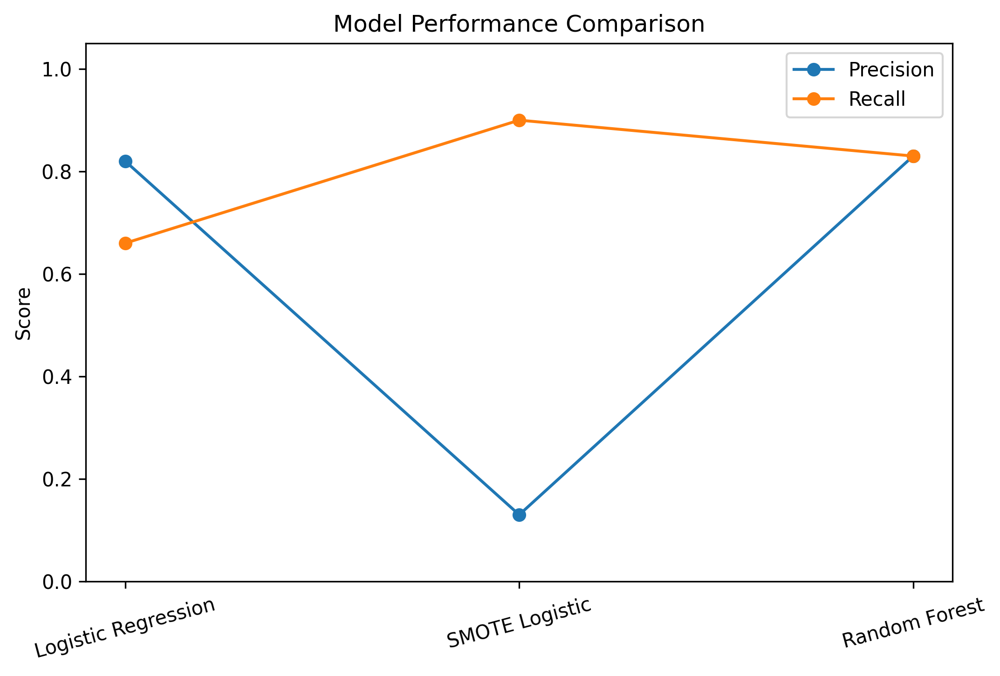
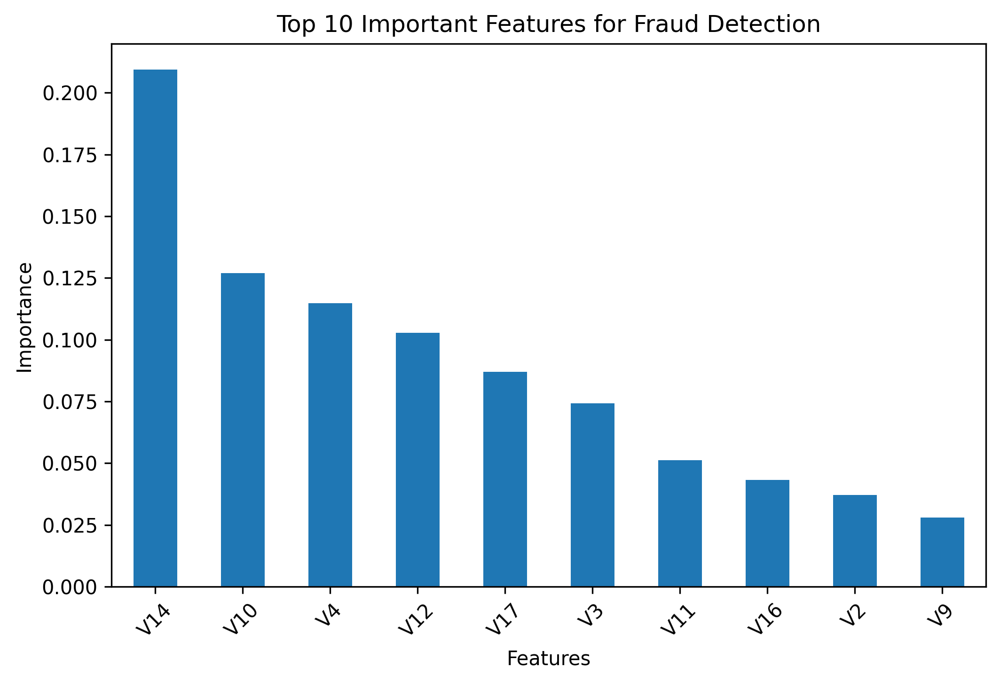

# Financial Fraud Detection Using Machine Learning

## Overview

This project builds a machine learning model to detect fraudulent credit card transactions using real-world (anonymized) transaction data. The goal isn't just to catch fraud, but to catch it without flagging too many genuine transactions as fraud, since that hurts the customer experience just as much as missed fraud hurts the business.

## Business Problem

Fraud is rare compared to normal transactions, which creates a class imbalance problem, i.e. the model can score high accuracy just by predicting "not fraud" every time, while completely missing actual fraud cases. So the real challenge isn't just building a model, it's building one that:
- Catches as much real fraud as possible (high recall)
- Doesn't flood the business with false alarms (manageable false positives)
- Stays interpretable enough to explain to a non-technical stakeholder

## Dataset

- Kaggle's anonymized credit card transaction dataset: https://www.kaggle.com/datasets/mlg-ulb/creditcardfraud
- Features: V1-V28 (PCA-transformed variables), Amount, Time, and Class (0 = normal, 1 = fraud)
- Dataset not included in this repo due to file size - use the Kaggle link above

## Project Workflow

**1. Data Understanding**
Looked at the dataset structure and feature distributions, and confirmed the severe class imbalance (fraud is a tiny fraction of all transactions).

**2. Exploratory Data Analysis**
Looked at class distribution, transaction amount patterns, and how fraudulent transactions behave differently from normal ones.

**3. Data Preprocessing**
Scaled the Amount and Time features, split the data into train/test sets, and handled the class imbalance using SMOTE (Synthetic Minority Oversampling Technique).

**4. Model Development**
Built and compared three models:
- Logistic Regression (baseline)
- Logistic Regression with SMOTE
- Random Forest Classifier

**5. Model Evaluation**
Compared models using Confusion Matrix, Precision, Recall, and F1-score, since accuracy alone is misleading on imbalanced data like this.

## Model Performance Summary

Results on the held-out test set (56,962 transactions, 98 of them fraud). Precision and recall are for the fraud class.

| Model | Precision | Recall | Interpretation |
|---|---|---|---|
| Logistic Regression | 0.82 | 0.66 | Misses about a third of fraud cases |
| SMOTE + Logistic Regression | 0.13 | 0.90 | Catches most fraud, but floods the business with false alarms |
| **Random Forest** | **0.83** | **0.83** | **Best overall balance** |



## Final Model - Random Forest

Random Forest gave the best balance overall:
- **Precision: 0.83** and **Recall: 0.83** (F1: 0.83)
- Caught **81 of 98** fraud cases in the test set
- Only **17 false alarms** out of 56,864 genuine transactions

## Key Insights

- Class imbalance has a big impact on model performance if it isn't handled properly
- SMOTE helps recall (catching more fraud) but comes at the cost of more false positives
- Random Forest handles the complex, non-linear patterns in fraud behaviour better than a linear model like Logistic Regression
- A small set of features drives most of the fraud detection - the model doesn't need to weigh everything equally

## Feature Importance

The top features driving fraud predictions were:
- V14
- V10
- V4
- V12



## Tools & Technologies

- Python
- Pandas, NumPy
- Matplotlib, Seaborn
- Scikit-learn
- imbalanced-learn (for SMOTE)
- Jupyter Notebook

## How to Run

1. Clone the repository
2. Install dependencies:
```bash
pip install -r requirements.txt
```
3. Download the dataset from the Kaggle link above and place it in the project folder
4. Open and run `financial_fraud_detection.ipynb`
